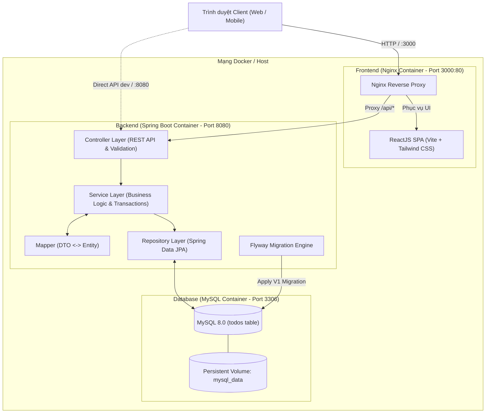

# Ứng Dụng Todo List Fullstack — Spring Boot 3 + ReactJS + MySQL + Docker + AWS Ready

Hệ thống quản lý công việc (Todo List) chuẩn production với kiến trúc phân lớp rõ ràng, tách biệt hoàn toàn Backend (Spring Boot 3 - Java 21), Frontend (ReactJS - Vite - Tailwind CSS) và Cơ sở dữ liệu (MySQL 8.0 với Flyway Migration). Hệ thống hỗ trợ chạy độc lập cho môi trường phát triển (Local Development) và đóng gói trọn gói qua Docker Compose hoặc triển khai lên AWS (ECS Fargate, RDS MySQL, ALB) thông qua Terraform.

---

## Mục lục

1. [Kiến trúc hệ thống](#1-kiến-trúc-hệ-thống)
2. [Cấu trúc thư mục dự án](#2-cấu-trúc-thư-mục-dự-án)
3. [Công nghệ sử dụng](#3-công-nghệ-sử-dụng)
4. [Yêu cầu môi trường & Cài đặt](#4-yêu-cầu-môi-trường--cài-đặt)
5. [Hướng dẫn chạy ứng dụng bằng Docker Compose](#5-hướng-dẫn-chạy-ứng-dụng-bằng-docker-compose)
6. [Hướng dẫn chạy Local Development](#6-hướng-dẫn-chạy-local-development)
   - [6.1 Khởi động MySQL Database](#61-khởi-động-mysql-database)
   - [6.2 Khởi động Backend (Spring Boot)](#62-khởi-động-backend-spring-boot)
   - [6.3 Khởi động Frontend (React Vite)](#63-khởi-động-frontend-react-vite)
7. [Tài liệu REST API & Hướng dẫn Test với cURL](#7-tài-liệu-rest-api--hướng-dẫn-test-với-curl)
8. [Quy trình Quản lý Database Migration (Flyway)](#8-quy-trình-quản-lý-database-migration-flyway)
9. [Kiểm thử tự động (Unit Tests) & Đóng gói (Build)](#9-kiểm-thử-tự-động-unit-tests--đóng-gói-build)
10. [Xử lý sự cố thường gặp (Troubleshooting)](#10-xử-lý-sự-cố-thường-gặp-troubleshooting)
11. [Sẵn sàng triển khai AWS (Production Deployment)](#11-sẵn-sàng-triển-khai-aws-production-deployment)

---

## 1. Kiến trúc hệ thống

Ứng dụng áp dụng mô hình phân lớp chuẩn công nghiệp (Layered Architecture) với tính độc lập cao giữa giao diện, nghiệp vụ và lưu trữ:



### Chi tiết kiến trúc Backend
- **Controller**: Chỉ tiếp nhận HTTP Request, xác thực dữ liệu đầu vào (`@Valid`), điều phối tham số lọc/phân trang/sắp xếp và trả về `ResponseEntity<ApiResponse<T>>`.
- **Service & Service Impl**: Tách biệt interface và implementation. Quản lý transactional (`@Transactional`), các quy tắc nghiệp vụ, kiểm tra trạng thái và ném ngoại lệ tùy biến (`ResourceNotFoundException`).
- **DTOs & Mapper**: Phân tách dữ liệu: `CreateTodoRequest`, `UpdateTodoRequest`, `UpdateStatusRequest`, `TodoResponse`, `TodoStatsResponse`, `PageResponse`. Entity không bao giờ bị lộ trực tiếp ra ngoài API.
- **Repository & Specification**: Sử dụng `JpaRepository` kết hợp `JpaSpecificationExecutor` để thực hiện dynamic query (tìm kiếm theo từ khóa trong tiêu đề/mô tả, lọc trạng thái, lọc mức độ ưu tiên) kết hợp phân trang (`Pageable`) và sắp xếp đa tiêu chí.
- **Global Exception Handler**: Bắt toàn bộ lỗi với `@RestControllerAdvice`, chuẩn hóa mã lỗi HTTP (400, 404, 500) và format JSON nhất quán.

---

## 2. Cấu trúc thư mục dự án

```text
Springboot-React-MySQL-AWS/
├── backend/
│   ├── .mvn/wrapper/
│   │   ├── maven-wrapper.jar
│   │   └── maven-wrapper.properties
│   ├── src/
│   │   ├── main/
│   │   │   ├── java/com/example/todo/
│   │   │   │   ├── config/
│   │   │   │   │   └── CorsConfig.java
│   │   │   │   ├── controller/
│   │   │   │   │   └── TodoController.java
│   │   │   │   ├── dto/
│   │   │   │   │   ├── request/
│   │   │   │   │   │   ├── CreateTodoRequest.java
│   │   │   │   │   │   ├── UpdateStatusRequest.java
│   │   │   │   │   │   └── UpdateTodoRequest.java
│   │   │   │   │   └── response/
│   │   │   │   │       ├── ApiResponse.java
│   │   │   │   │       ├── PageResponse.java
│   │   │   │   │       ├── TodoResponse.java
│   │   │   │   │       └── TodoStatsResponse.java
│   │   │   │   ├── entity/
│   │   │   │   │   ├── Priority.java
│   │   │   │   │   └── Todo.java
│   │   │   │   ├── exception/
│   │   │   │   │   ├── ErrorResponse.java
│   │   │   │   │   ├── GlobalExceptionHandler.java
│   │   │   │   │   └── ResourceNotFoundException.java
│   │   │   │   ├── mapper/
│   │   │   │   │   └── TodoMapper.java
│   │   │   │   ├── repository/
│   │   │   │   │   ├── TodoRepository.java
│   │   │   │   │   └── TodoSpecification.java
│   │   │   │   ├── service/
│   │   │   │   │   ├── impl/
│   │   │   │   │   │   └── TodoServiceImpl.java
│   │   │   │   │   └── TodoService.java
│   │   │   │   └── TodoApplication.java
│   │   │   └── resources/
│   │   │       ├── db/migration/
│   │   │       │   └── V1__create_todos_table.sql
│   │   │       ├── application.yml
│   │   │       └── application-docker.yml
│   │   └── test/
│   │       ├── java/com/example/todo/service/
│   │       │   └── TodoServiceTest.java
│   │       └── resources/
│   │           └── application.yml
│   ├── .dockerignore
│   ├── .gitignore
│   ├── Dockerfile
│   ├── mvnw
│   ├── mvnw.cmd
│   └── pom.xml
│
├── frontend/
│   ├── public/
│   │   └── vite.svg
│   ├── src/
│   │   ├── api/
│   │   │   ├── axiosClient.js
│   │   │   └── todoApi.js
│   │   ├── assets/
│   │   ├── components/
│   │   │   ├── common/
│   │   │   │   ├── Badge.jsx
│   │   │   │   ├── ConfirmDialog.jsx
│   │   │   │   ├── Footer.jsx
│   │   │   │   ├── LoadingSkeleton.jsx
│   │   │   │   ├── Modal.jsx
│   │   │   │   ├── Navbar.jsx
│   │   │   │   ├── Pagination.jsx
│   │   │   │   ├── Spinner.jsx
│   │   │   │   ├── StatCard.jsx
│   │   │   │   └── Toast.jsx
│   │   │   └── todos/
│   │   │       ├── TodoCard.jsx
│   │   │       ├── TodoFilterBar.jsx
│   │   │       ├── TodoFormModal.jsx
│   │   │       ├── TodoList.jsx
│   │   │       ├── TodoSearch.jsx
│   │   │       └── TodoStats.jsx
│   │   ├── hooks/
│   │   │   └── useTodos.js
│   │   ├── layouts/
│   │   │   └── MainLayout.jsx
│   │   ├── pages/
│   │   │   ├── HomePage.jsx
│   │   │   └── NotFoundPage.jsx
│   │   ├── services/
│   │   │   └── todoService.js
│   │   ├── utils/
│   │   │   ├── constants.js
│   │   │   └── formatters.js
│   │   ├── App.jsx
│   │   ├── index.css
│   │   └── main.jsx
│   ├── .dockerignore
│   ├── .env.example
│   ├── .gitignore
│   ├── Dockerfile
│   ├── index.html
│   ├── nginx.conf
│   ├── package.json
│   ├── postcss.config.js
│   ├── tailwind.config.js
│   └── vite.config.js
│
├── terraform/                       # Hạ tầng AWS (ALB, ECS Fargate, RDS MySQL, VPC)
├── .env.example                     # Biến môi trường mẫu cho Docker Compose
├── .gitignore                       # Git ignore dùng chung
├── docker-compose.yml               # Cấu hình khởi chạy 3 services (MySQL, Backend, Frontend)
└── README.md
```

---

## 3. Công nghệ sử dụng

| Lớp | Công nghệ | Phiên bản | Mục đích |
|---|---|---|---|
| **Backend** | Java | 21 (LTS) | Ngôn ngữ lập trình chính |
| | Spring Boot | 3.3.5 | Framework ứng dụng doanh nghiệp |
| | Spring Web | 3.3.5 | Xây dựng RESTful API controllers |
| | Spring Data JPA | 3.3.5 | Tương tác cơ sở dữ liệu qua ORM Hibernate |
| | Spring Validation | 3.3.5 | Xác thực ràng buộc dữ liệu đầu vào |
| | MySQL Connector/J | 8.3.0 | Driver JDBC kết nối cơ sở dữ liệu MySQL |
| | Flyway | 10.x | Quản lý phiên bản và migration cơ sở dữ liệu |
| | Lombok | 1.18.36 | Giảm thiểu boilerplate code (Getter, Setter, Builder) |
| | Maven & Wrapper | 3.9.9 | Quản lý thư viện phụ thuộc và build hệ thống |
| | JUnit 5 & Mockito | 5.x / 5.x | Kiểm thử đơn vị (Unit Tests) tầng nghiệp vụ |
| **Frontend** | ReactJS | 18.3.1 | Thư viện xây dựng giao diện người dùng |
| | Vite | 5.4.10 | Công cụ build và máy chủ phát triển siêu tốc |
| | React Router DOM | 6.27.0 | Định tuyến trang Single Page Application (SPA) |
| | Axios | 1.7.7 | HTTP Client gọi REST API có Interceptor |
| | Tailwind CSS | 3.4.14 | Framework tiện ích tạo kiểu giao diện hiện đại |
| | Lucide React | 0.454.0 | Bộ biểu tượng SVG vector nhẹ và nhất quán |
| **Database** | MySQL | 8.0 | Hệ quản trị cơ sở dữ liệu quan hệ chính |
| **DevOps** | Docker | Multi-stage | Đóng gói tối ưu dung lượng (Temurin JRE & Nginx Alpine) |
| | Docker Compose | v2 | Điều phối mạng, volume và thứ tự khởi chạy container |
| | Nginx | 1.27-alpine | Web server phục vụ tĩnh & Reverse Proxy API |
| | AWS / Terraform | - | Hạ tầng đám mây sẵn sàng mở rộng (VPC, ECS, RDS) |

---

## 4. Yêu cầu môi trường & Cài đặt

Nếu muốn phát triển và chạy ứng dụng độc lập trên máy tính (không dùng Docker), bạn cần cài đặt:

1. **Java Development Kit (JDK 21 LTS)**:
   - Tải từ [Eclipse Temurin 21](https://adoptium.net/) hoặc [Amazon Corretto 21](https://aws.amazon.com/corretto/).
   - Kiểm tra bằng lệnh:
     ```bash
     java -version
     ```
2. **Node.js (v18+ hoặc v20+) & npm**:
   - Tải từ [Nodejs.org](https://nodejs.org/).
   - Kiểm tra bằng lệnh:
     ```bash
     node -v
     npm -v
     ```
3. **MySQL Server 8.0**:
   - Tải và cài đặt [MySQL Community Server](https://dev.mysql.com/downloads/mysql/). Hoặc chạy nhanh bằng Docker:
     ```bash
     docker run -d --name mysql-dev -p 3306:3306 -e MYSQL_ROOT_PASSWORD=secret -e MYSQL_DATABASE=tododb mysql:8.0
     ```
4. **Docker & Docker Compose (Khuyên dùng)**:
   - Cài đặt [Docker Desktop](https://www.docker.com/products/docker-desktop/) (Windows/macOS) hoặc Docker Engine (Linux).

---

## 5. Hướng dẫn chạy ứng dụng bằng Docker Compose

Đây là cách chạy nhanh nhất, tự động xây dựng và cấu hình cả 3 thành phần: MySQL, Backend và Frontend.

### Bước 1: Chuẩn bị file biến môi trường

Sao chép file `.env.example` thành file `.env` ở thư mục gốc:

```bash
# Trên Windows PowerShell:
Copy-Item .env.example .env

# Trên Linux / macOS:
cp .env.example .env
```

Nội dung mặc định trong `.env`:
```env
MYSQL_ROOT_PASSWORD=secret
MYSQL_DATABASE=tododb
MYSQL_USER=todouser
MYSQL_PASSWORD=secret
MYSQL_PORT=3306
SERVER_PORT=8080
FRONTEND_PORT=3000
SPRING_PROFILES_ACTIVE=docker
CORS_ALLOWED_ORIGINS=http://localhost:3000,http://localhost:80
VITE_API_BASE_URL=/api/v1
```

### Bước 2: Khởi chạy toàn bộ hệ thống bằng một lệnh duy nhất

```bash
docker compose up --build -d
```

### Bước 3: Kiểm tra trạng thái các container

```bash
docker compose ps
```

Kết quả mong đợi:
- `todo-mysql`: Trạng thái `healthy` trên cổng `3306`.
- `todo-backend`: Trạng thái `healthy` hoặc `running` trên cổng `8080`.
- `todo-frontend`: Trạng thái `running` trên cổng `3000` (ánh xạ từ Nginx port 80).

### Bước 4: Truy cập ứng dụng
- **Giao diện người dùng (Frontend)**: [http://localhost:3000](http://localhost:3000)
- **API Backend**: [http://localhost:8080/api/v1/todos](http://localhost:8080/api/v1/todos)
- **API Thống kê**: [http://localhost:8080/api/v1/todos/stats](http://localhost:8080/api/v1/todos/stats)

### Bước 5: Xem logs hoặc dừng hệ thống
```bash
# Xem log thời gian thực:
docker compose logs -f

# Dừng toàn bộ hệ thống:
docker compose down

# Dừng và xóa toàn bộ dữ liệu volume (reset database):
docker compose down -v
```

---

## 6. Hướng dẫn chạy Local Development

Dành cho nhà phát triển muốn sửa đổi mã nguồn và chạy hot-reload trực tiếp.

### 6.1 Khởi động MySQL Database

Nếu bạn đã có MySQL local, tạo cơ sở dữ liệu `tododb`:
```sql
CREATE DATABASE IF NOT EXISTS tododb CHARACTER SET utf8mb4 COLLATE utf8mb4_unicode_ci;
```

Hoặc khởi chạy MySQL qua Docker container độc lập:
```bash
docker run -d --name mysql-local \
  -p 3306:3306 \
  -e MYSQL_ROOT_PASSWORD=secret \
  -e MYSQL_DATABASE=tododb \
  mysql:8.0
```

### 6.2 Khởi động Backend (Spring Boot)

1. Di chuyển vào thư mục `backend`:
   ```bash
   cd backend
   ```
2. Cấu hình biến môi trường kết nối database (hoặc để mặc định theo `application.yml`):
   ```bash
   # Windows PowerShell
   $env:DB_HOST="localhost"
   $env:DB_PORT="3306"
   $env:DB_NAME="tododb"
   $env:DB_USER="root"
   $env:DB_PASSWORD="secret"

   # Linux / macOS
   export DB_HOST=localhost
   export DB_PORT=3306
   export DB_NAME=tododb
   export DB_USER=root
   export DB_PASSWORD=secret
   ```
3. Khởi chạy Backend bằng Maven Wrapper:
   ```bash
   # Windows
   .\mvnw.cmd spring-boot:run

   # Linux / macOS
   ./mvnw spring-boot:run
   ```
4. Khi khởi chạy, Flyway sẽ tự động chạy migration `V1__create_todos_table.sql`, tạo bảng `todos` và chèn các công việc mẫu ban đầu.
5. Backend lắng nghe tại: `http://localhost:8080`.

### 6.3 Khởi động Frontend (React Vite)

1. Mở một cửa sổ dòng lệnh mới và di chuyển vào thư mục `frontend`:
   ```bash
   cd frontend
   ```
2. Cài đặt các thư viện:
   ```bash
   npm install
   ```
3. Khởi chạy máy chủ phát triển Vite:
   ```bash
   npm run dev
   ```
4. Mở trình duyệt và truy cập: [http://localhost:5173](http://localhost:5173).
   - Vite đã được cấu hình proxy tự động chuyển tiếp mọi request `/api/*` tới Backend tại `http://localhost:8080`.

---

## 7. Tài liệu REST API & Hướng dẫn Test với cURL

Tất cả các API đều có tiền tố `/api/v1/todos` và trả về cấu trúc JSON chuẩn nhất quán:

```json
{
  "success": true,
  "message": "Thành công",
  "data": { ... },
  "timestamp": "2026-11-06T20:30:00"
}
```

### 1. Lấy danh sách công việc (có tìm kiếm, lọc, sắp xếp, phân trang)
- **Method:** `GET`
- **URL:** `/api/v1/todos`
- **Query Parameters:**
  - `search` (chuỗi): Tìm theo từ khóa trong tiêu đề hoặc mô tả (không phân biệt hoa thường).
  - `completed` (boolean): `true` (đã xong), `false` (chưa xong). Bỏ trống để lấy tất cả.
  - `priority` (enum): `LOW`, `MEDIUM`, `HIGH`. Bỏ trống để lấy tất cả.
  - `page` (int, default: `0`): Chỉ số trang bắt đầu từ 0.
  - `size` (int, default: `10`): Số lượng phần tử mỗi trang.
  - `sortBy` (string, default: `createdAt`): Trường sắp xếp (`createdAt`, `dueDate`, `priority`, `title`).
  - `sortDir` (string, default: `desc`): Chiều sắp xếp (`asc` hoặc `desc`).

```bash
# Lấy danh sách mặc định
curl -X GET "http://localhost:8080/api/v1/todos"

# Tìm kiếm từ khóa "Spring", độ ưu tiên HIGH, sắp xếp theo hạn chót tăng dần
curl -X GET "http://localhost:8080/api/v1/todos?search=Spring&priority=HIGH&sortBy=dueDate&sortDir=asc&page=0&size=5"
```

### 2. Xem thống kê Dashboard
- **Method:** `GET`
- **URL:** `/api/v1/todos/stats`

```bash
curl -X GET "http://localhost:8080/api/v1/todos/stats"
```

*Phản hồi mẫu:*
```json
{
  "success": true,
  "message": "Success",
  "data": {
    "total": 4,
    "completed": 1,
    "pending": 3,
    "highPriority": 2
  }
}
```

### 3. Lấy chi tiết công việc theo ID
- **Method:** `GET`
- **URL:** `/api/v1/todos/{id}`

```bash
curl -X GET "http://localhost:8080/api/v1/todos/1"
```

### 4. Tạo công việc mới
- **Method:** `POST`
- **URL:** `/api/v1/todos`
- **Headers:** `Content-Type: application/json`

```bash
curl -X POST "http://localhost:8080/api/v1/todos" \
  -H "Content-Type: application/json" \
  -d '{
    "title": "Cấu hình CI/CD GitHub Actions",
    "description": "Tự động build Docker image và đẩy lên AWS ECR khi push code lên nhánh main.",
    "priority": "HIGH",
    "dueDate": "2026-11-15T18:00:00"
  }'
```

### 5. Cập nhật toàn bộ công việc
- **Method:** `PUT`
- **URL:** `/api/v1/todos/{id}`
- **Headers:** `Content-Type: application/json`

```bash
curl -X PUT "http://localhost:8080/api/v1/todos/1" \
  -H "Content-Type: application/json" \
  -d '{
    "title": "Thiết kế kiến trúc hệ thống Fullstack (Hoàn thiện)",
    "description": "Đã hoàn thành sơ đồ luồng dữ liệu và thiết lập hạ tầng Docker.",
    "priority": "HIGH",
    "completed": true,
    "dueDate": "2026-11-10T23:59:59"
  }'
```

### 6. Cập nhật nhanh trạng thái hoàn thành
- **Method:** `PATCH`
- **URL:** `/api/v1/todos/{id}/status`
- **Headers:** `Content-Type: application/json`

```bash
curl -X PATCH "http://localhost:8080/api/v1/todos/2/status" \
  -H "Content-Type: application/json" \
  -d '{"completed": true}'
```

### 7. Xóa công việc
- **Method:** `DELETE`
- **URL:** `/api/v1/todos/{id}`

```bash
curl -X DELETE "http://localhost:8080/api/v1/todos/3"
```

---

## 8. Quy trình Quản lý Database Migration (Flyway)

Để đảm bảo tính toàn vẹn dữ liệu cho môi trường Production, dự án không sử dụng `hibernate.ddl-auto=update` mà chuyển quyền quản lý cấu trúc bảng cho **Flyway**:

1. File migration nằm tại: `backend/src/main/resources/db/migration/V1__create_todos_table.sql`.
2. Định nghĩa cấu trúc bảng:
   ```sql
   CREATE TABLE IF NOT EXISTS todos (
       id BIGINT AUTO_INCREMENT PRIMARY KEY,
       title VARCHAR(255) NOT NULL,
       description TEXT,
       completed BOOLEAN NOT NULL DEFAULT FALSE,
       priority VARCHAR(20) NOT NULL DEFAULT 'MEDIUM',
       due_date DATETIME NULL,
       created_at DATETIME NOT NULL DEFAULT CURRENT_TIMESTAMP,
       updated_at DATETIME NOT NULL DEFAULT CURRENT_TIMESTAMP ON UPDATE CURRENT_TIMESTAMP,
       INDEX idx_todos_completed (completed),
       INDEX idx_todos_priority (priority),
       INDEX idx_todos_created_at (created_at),
       INDEX idx_todos_due_date (due_date)
   ) ENGINE=InnoDB DEFAULT CHARSET=utf8mb4 COLLATE=utf8mb4_unicode_ci;
   ```
3. Khi bổ sung cột hoặc thay đổi bảng trong tương lai:
   - Tạo file tiếp theo theo quy tắc đặt tên: `V2__add_new_column_to_todos.sql`.
   - Tuyệt đối không chỉnh sửa nội dung các file migration cũ đã chạy trên production để tránh lỗi checksum.

---

## 9. Kiểm thử tự động (Unit Tests) & Đóng gói (Build)

### 9.1 Chạy Unit Test Backend
Bộ kiểm thử tầng Service được viết bằng JUnit 5 & Mockito, mô phỏng hoàn toàn Repository và xác minh logic kinh doanh:

```bash
cd backend
.\mvnw.cmd test
```

### 9.2 Đóng gói file JAR Backend
```bash
cd backend
.\mvnw.cmd clean package -DskipTests
```
File JAR tạo ra tại: `backend/target/todo-backend-1.0.0.jar`.

### 9.3 Đóng gói Frontend Production
```bash
cd frontend
npm run build
```
Bộ mã tĩnh tối ưu được sinh ra tại: `frontend/dist/`.

---

## 10. Xử lý sự cố thường gặp (Troubleshooting)

### 1. Lỗi cổng đang được sử dụng (Port 3306, 8080 hoặc 3000)
- **Hiện tượng**: Báo lỗi `bind: address already in use`.
- **Cách xử lý**:
  - Kiểm tra tiến trình đang chiếm cổng:
    ```bash
    # Windows
    netstat -ano | findstr :3306
    netstat -ano | findstr :8080
    netstat -ano | findstr :3000
    ```
  - Hoặc điều chỉnh cổng khác trong file `.env` (ví dụ `MYSQL_PORT=3307`, `SERVER_PORT=8081`, `FRONTEND_PORT=3001`).

### 2. Backend không kết nối được MySQL trong Docker Compose
- **Hiện tượng**: Backend log xuất hiện `Communications link failure`.
- **Nguyên nhân & Khắc phục**:
  - `docker-compose.yml` đã được trang bị `healthcheck` cho dịch vụ `mysql` và cấu hình `depends_on: mysql: condition: service_healthy`.
  - Luôn đảm bảo tên host trong chuỗi kết nối của container Backend là `mysql` (tên service trong docker-compose), không dùng `localhost`.

### 3. Lỗi CORS (Cross-Origin Resource Sharing)
- **Hiện tượng**: Trình duyệt báo `Access-Control-Allow-Origin missing`.
- **Cách xử lý**:
  - Kiểm tra biến `CORS_ALLOWED_ORIGINS` trong `.env` đã có URL của frontend bạn đang truy cập chưa (mặc định đã hỗ trợ `http://localhost:3000` và `http://localhost:5173`).
  - Lớp `CorsConfig.java` cho phép đầy đủ các phương thức HTTP: GET, POST, PUT, PATCH, DELETE, OPTIONS.

### 4. Lỗi Flyway Migration Checksum
- **Hiện tượng**: `Migration checksum mismatch for migration version 1`.
- **Cách xử lý**: Khi ở môi trường dev nếu bạn vô tình sửa file migration `V1`, xóa volume cũ bằng `docker compose down -v` rồi khởi động lại `docker compose up --build -d`.

---

## 11. Sẵn sàng triển khai AWS (Production Deployment)

Dự án đã sẵn sàng để tích hợp vào hạ tầng Terraform có sẵn tại thư mục `terraform/`:
- **AWS ECR**: Lưu trữ Docker images cho `backend` và `frontend`.
- **AWS ECS Fargate**: Khởi chạy container backend Spring Boot và frontend Nginx mà không cần quản lý máy chủ EC2.
- **AWS RDS MySQL**: Cơ sở dữ liệu MySQL 8.0 được quản lý toàn diện với Multi-AZ, tự động sao lưu.
- **Application Load Balancer (ALB)**: Phân phối tải, quản lý chứng chỉ SSL/TLS và chuyển hướng lưu lượng.

---

*Dự án hoàn thành bởi Senior Fullstack Developer — Thiết kế theo chuẩn Production.*
