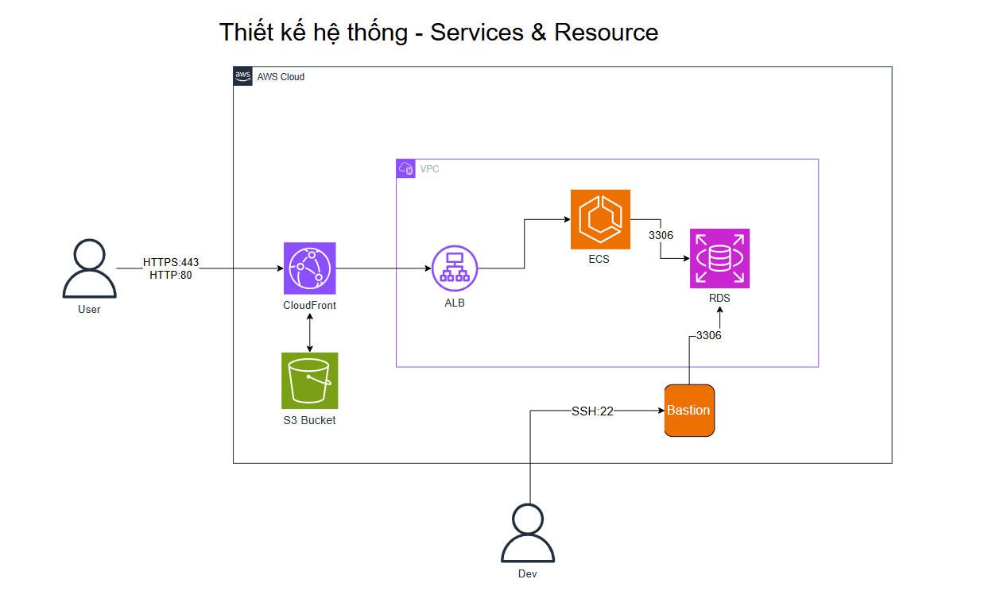
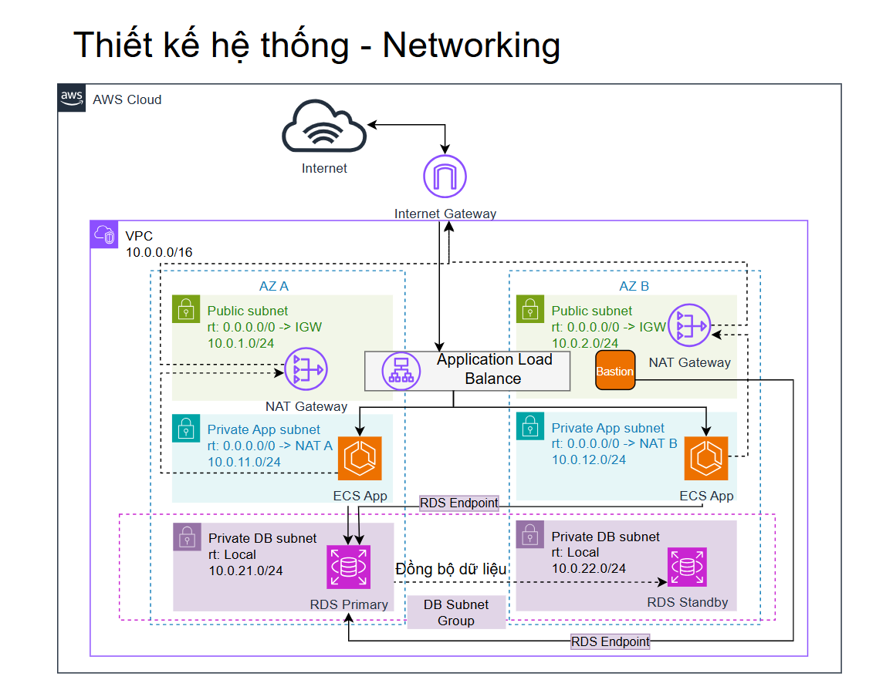
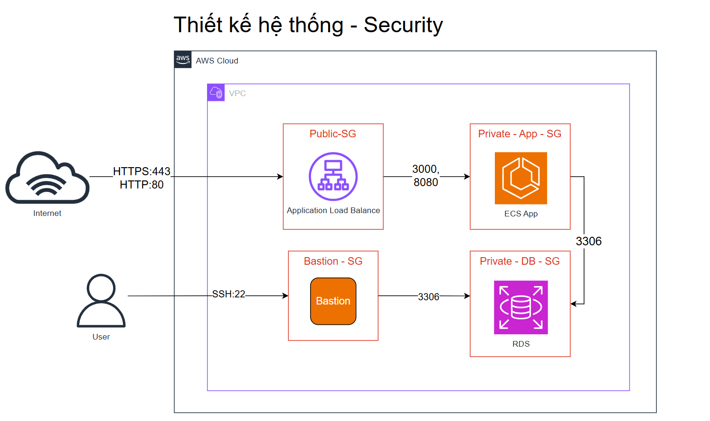

# AWS Architecture Design – Springboot React MySQL AWS

Dự án được thiết kế để triển khai một ứng dụng Todo List Fullstack trên AWS theo hướng tách biệt rõ ràng giữa **networking**, **application**, **database** và **frontend delivery**.

Kiến trúc sử dụng các thành phần chính:

- **Amazon VPC**
- **Public Subnets / Private Subnets**
- **Internet Gateway**
- **NAT Gateway**
- **Application Load Balancer (ALB)**
- **Amazon ECS Fargate**
- **Amazon RDS MySQL**
- **Amazon S3**
- **Amazon CloudFront**
- **AWS Secrets Manager**
- **Terraform Remote State (S3 + KMS)**

---

## 1. Tổng quan kiến trúc trên AWS

Hệ thống được chia thành 2 phần chính:

- **Frontend delivery**
  - React frontend được build thành static files
  - Lưu trữ trên **Amazon S3**
  - Phân phối qua **Amazon CloudFront**
- **Backend application**
  - Spring Boot backend chạy trên **Amazon ECS Fargate**
  - Truy cập qua **Application Load Balancer**
  - Kết nối dữ liệu tới **Amazon RDS MySQL**

Ngoài ra, dự án sử dụng **Terraform** để quản lý hạ tầng theo từng stack riêng biệt:

- `networking`
- `database`
- `registry`
- `application`
- `frontend`

---

## 2. Kiến trúc Services & Resource

### Mô tả

- Người dùng truy cập hệ thống từ Internet.
- **CloudFront** đóng vai trò entry point cho frontend.
- **S3 Bucket** lưu trữ static files của React app.
- Với các request giao diện:
  - CloudFront lấy nội dung từ **S3**
- Với các request API:
  - CloudFront chuyển tiếp đến **ALB**
  - ALB phân phối lưu lượng đến **ECS Fargate**
- Backend trên ECS kết nối đến **RDS MySQL** để đọc/ghi dữ liệu.

### Vai trò của từng dịch vụ

- **CloudFront**: tăng tốc phân phối nội dung frontend và làm điểm truy cập chung cho frontend/API.
- **S3**: lưu file frontend sau khi build.
- **ALB**: cân bằng tải cho backend service.
- **ECS Fargate**: chạy container Spring Boot backend.
- **RDS MySQL**: lưu trữ dữ liệu nghiệp vụ Todo.

---

## 3. Kiến trúc Networking

### Mô tả mạng

Hệ thống được triển khai trong một **VPC CIDR `10.0.0.0/16`** và phân bố trên **2 Availability Zones** để tăng tính sẵn sàng.

### Phân chia subnet

#### Public Subnets

- **AZ A:** `10.0.1.0/24`
- **AZ B:** `10.0.2.0/24`

Public Subnets chứa:

- **Application Load Balancer**
- **NAT Gateway**

Các subnet này có route:

- `0.0.0.0/0 -> Internet Gateway`

#### Private App Subnets

- **AZ A:** `10.0.11.0/24`
- **AZ B:** `10.0.12.0/24`

Private App Subnets chứa:

- **ECS Fargate tasks**

Các subnet này đi Internet outbound thông qua NAT Gateway:

- `0.0.0.0/0 -> NAT Gateway`

#### Private DB Subnets

- **AZ A:** `10.0.21.0/24`
- **AZ B:** `10.0.22.0/24`

Private DB Subnets chứa:

- **Amazon RDS MySQL**
- DB Subnet Group dùng cho Multi-AZ deployment

Các subnet DB không public ra Internet và chỉ phục vụ kết nối nội bộ trong VPC.

### Các thành phần mạng chính

- **Internet Gateway**
  - Cho phép Public Subnets giao tiếp với Internet
- **NAT Gateway**
  - Cho phép ECS trong private subnets truy cập outbound Internet khi cần
- **DB Subnet Group**
  - Gom các DB subnets để triển khai RDS Multi-AZ

---

## 4. Kiến trúc Security

### Nguyên tắc bảo mật

Hệ thống tách riêng Security Group theo từng lớp:

- **ALB Security Group**
- **ECS Security Group**
- **RDS Security Group**
- **Bastion Security Group** (phục vụ cho thiết kế quản trị DB nếu cần)

### Luồng truy cập bảo mật

#### Internet → ALB

- Cho phép:
  - `HTTP :80`
  - `HTTPS :443`

#### ALB → ECS

- Chỉ ALB mới được phép gọi vào ECS application port
- Backend không public trực tiếp ra Internet

#### ECS → RDS

- Chỉ ECS Security Group mới được phép kết nối đến RDS qua port:
  - `3306`

#### Bastion → RDS

- Trong thiết kế mở rộng, Bastion có thể được sử dụng để quản trị DB nội bộ
- Kết nối:
  - `SSH :22` vào Bastion
  - `3306` từ Bastion tới RDS

### Ý nghĩa của mô hình security

- Giảm bề mặt tấn công
- Không public backend service trực tiếp
- Database chỉ chấp nhận truy cập từ các nguồn tin cậy trong VPC
- Dễ kiểm soát và audit traffic giữa các lớp

---

## 5. Luồng request trong hệ thống

### Frontend request

1. Người dùng truy cập frontend qua CloudFront
2. CloudFront lấy static files từ S3
3. Trình duyệt tải giao diện React

### API request

1. Frontend gọi API theo đường dẫn `/api/*`
2. CloudFront forward request đến ALB
3. ALB chuyển tiếp đến ECS Fargate service
4. Backend xử lý nghiệp vụ
5. Backend truy vấn hoặc cập nhật dữ liệu trên RDS
6. Kết quả trả ngược lại cho người dùng

---

## 6. Thành phần hạ tầng được quản lý bằng Terraform

Dự án tổ chức Terraform theo từng stack để dễ quản lý và tái sử dụng:

### `terraform/bootstrap/terraform-state`

Thiết lập:

- S3 bucket lưu Terraform remote state
- KMS key mã hóa state
- IAM policy cho backend access

### `terraform/environments/prod/networking`

Triển khai:

- VPC
- Public subnets
- Private app subnets
- Private DB subnets
- Internet Gateway
- NAT Gateway
- Route tables
- Security Groups

### `terraform/environments/prod/database`

Triển khai:

- Amazon RDS MySQL
- DB subnet group
- Parameter group
- CloudWatch log groups
- Secrets Manager integration cho master password

### `terraform/environments/prod/registry`

Triển khai:

- Amazon ECR repository cho backend image

### `terraform/environments/prod/application`

Triển khai:

- Application Load Balancer
- ECS Cluster
- ECS Service
- ECS Task Definition
- CloudWatch Logs
- Kết nối đến RDS thông qua Secrets Manager

### `terraform/environments/prod/frontend`

Triển khai:

- S3 bucket cho frontend
- CloudFront distribution
- Origin Access Control
- API routing `/api/*` về ALB

---

## 7. Điểm nổi bật của thiết kế AWS

- Kiến trúc phân lớp rõ ràng giữa:
  - **Network**
  - **Application**
  - **Database**
  - **Frontend Delivery**
- Backend chạy trong **private app subnets**
- Database chạy trong **private DB subnets**
- Frontend phân phối qua **CloudFront + S3**
- Hỗ trợ **Multi-AZ** cho database
- Hỗ trợ scale ứng dụng theo hướng containerized trên **ECS Fargate**
- Dễ tái triển khai hoặc destroy toàn bộ hạ tầng bằng Terraform

---

## 8. Ghi chú

- Các hình trong thư mục `docs/` mô tả kiến trúc triển khai và định hướng thiết kế hệ thống trên AWS.
- Đây là kiến trúc phù hợp cho mục tiêu học tập và thực hành triển khai Fullstack application trên AWS bằng Terraform.
